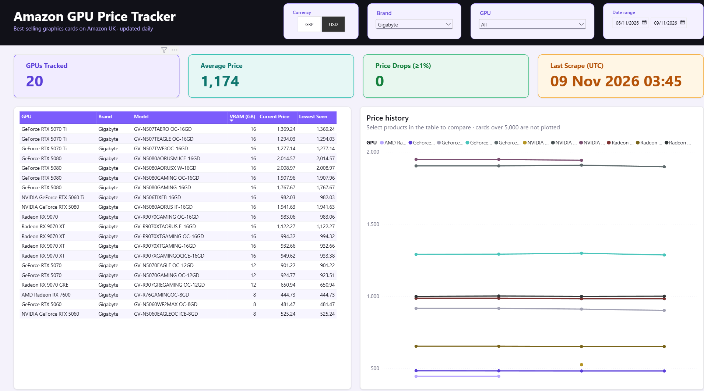
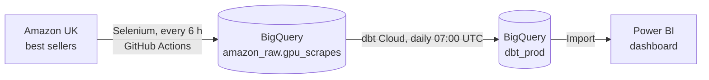

# Amazon GPU Price Tracker

An end-to-end data pipeline that tracks the prices of best-selling graphics cards on Amazon UK. A Python scraper runs every 6 hours, loads the results into BigQuery, dbt turns the raw scrapes into a dimension and a fact table, and a Power BI dashboard shows prices, price drops and price history.



## Architecture



| Stage | Tool | What it does |
|---|---|---|
| Extract | Python, Selenium | Collects product IDs (ASINs) from the first 5 pages of the best-seller list, then opens each product page and reads price, discount, rating, reviews, sales and specs |
| Load | BigQuery load jobs | Appends each run to `amazon_raw.gpu_scrapes`, partitioned by day and clustered by `asin` |
| Schedule | GitHub Actions | Runs the scraper every 6 hours and authenticates to Google Cloud with Workload Identity Federation, so no key file is stored in the repo |
| Transform | dbt Cloud | Cleans the raw data and builds `dim_product` and `fct_prices`, with 9 data tests, in a daily production job |
| Visualise | Power BI | KPI cards, a product table and a price history chart, filtered by currency, brand, GPU and date |

## Data model

**`stg_gpu_scrapes`** (view): cleans the raw rows. It turns the scraper's `unknown` placeholder into NULL, standardises the currency code (`£` → `GBP`) and converts graphics memory from GB or MB text into a number of GB.

**`dim_product`** (table): one row per GPU (`asin`) with its most recent known specs, plus when it was first and last seen and how many times it was scraped.

**`fct_prices`** (table): one row per product per scrape, with the price, original price, discount, rating, reviews and sales.

Tests cover unique and non-null keys, the relationship from `fct_prices` to `dim_product`, non-null prices and the accepted currency codes.

## Dashboard measures

| Measure | Meaning |
|---|---|
| GPUs Tracked | Number of distinct products in the current filter |
| Average Price | Average of each product's latest price |
| Price Drops (≥1%) | Products whose latest price is at least 1% below their highest recorded price |
| Last Scrape (UTC) | Time of the most recent scrape |
| Latest / Lowest Price | Per product, in the product table |

The dashboard is saved as a Power BI Project (PBIP), so the report and the semantic model, including the DAX measures, are plain text files that can be read and diffed in git.

## Project structure

```
.github/workflows/scheduled-run.yml   scheduled scraper run (every 6 hours)
src/
  main.py                             entry point: scrape, then load
  config.py                           reads settings from environment variables
  scraper/amazon.py                   Selenium scraper
  load/bigquery_loader.py             loads rows into BigQuery
dbt/
  dbt_project.yml
  models/staging/                     source definition and stg_gpu_scrapes
  models/marts/                       dim_product, fct_prices and their tests
dashboards/
  GPU_Price_Tracker.pbip              open this in Power BI Desktop
  GPU_Price_Tracker.Report/           report pages and visuals
  GPU_Price_Tracker.SemanticModel/    tables, relationship and DAX measures
docs/dashboard.png                    dashboard screenshot
```

## Running it locally

Requirements: Python 3.11+, Google Chrome, the [Google Cloud CLI](https://cloud.google.com/sdk/docs/install) and a Google Cloud project with BigQuery.

1. Install the dependencies:
   ```bash
   python -m venv .venv
   .venv\Scripts\activate          # on macOS/Linux: source .venv/bin/activate
   pip install -r requirements.txt
   ```
2. Copy `.env.example` to `.env` and fill in `GCP_PROJECT_ID` and `AMAZON_LISTING_URL`.
3. Sign in to Google Cloud so the BigQuery client can find your credentials:
   ```bash
   gcloud auth application-default login
   ```
4. Run the pipeline from the project root:
   ```bash
   python -m src.main
   ```

The dbt project lives in `dbt/` and runs in dbt Cloud. The dashboard opens from `dashboards/GPU_Price_Tracker.pbip`; it uses Import mode, so click **Refresh** to load the latest data.

## Notes and limitations

- **Currency:** Amazon shows prices in the visitor's currency. GitHub's runners are in the US, so scheduled runs usually record USD, while local runs record GBP. Every row keeps its `currency`, and the dashboard filters by it so prices in different currencies are never mixed.
- **Free tier:** the project runs in the BigQuery sandbox, so daily partitions expire after 60 days and data is loaded with load jobs instead of streaming inserts.
- **Product names:** sellers write the same GPU in different ways (for example "NVIDIA GeForce RTX 5080" and "GeForce RTX 5080"), and names are shown as Amazon lists them.
- **Scraping:** Amazon changes its page layout from time to time, which can break the CSS selectors in `src/scraper/amazon.py`.
